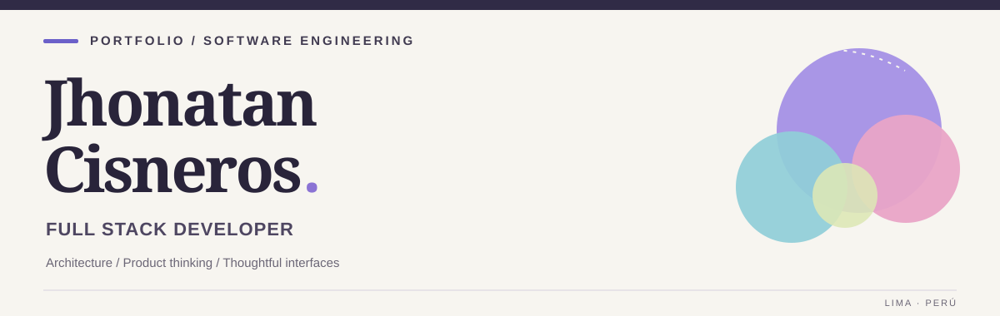

  

**Desarrollo web · Arquitectura de software · SaaS · Integraciones**

Construyo productos digitales de extremo a extremo: interfaces claras, servicios bien diseñados y soluciones preparadas para desplegarse y mantenerse.

**Lima, Perú** &nbsp;·&nbsp; [LinkedIn](https://www.linkedin.com/in/cinerosjorgejhonataneduardo) &nbsp;·&nbsp; [Correo](mailto:jhonatanjorge151@gmail.com)

---

## 01 / Perfil & filosofía

Soy desarrollador **Full Stack** y estudiante de **Ingeniería de Sistemas e Informática**. Participo en el desarrollo de aplicaciones web y productos SaaS, desde el diseño de interfaces y la construcción de APIs hasta el modelado de datos, las integraciones y el despliegue.

Mi base técnica más sólida está en **Java y Spring Boot**; la complemento con **TypeScript, React, Angular, Python, FastAPI y Node.js** para construir soluciones completas. También trabajo con bases de datos relacionales y NoSQL, contenedores e infraestructura Linux.

Me interesa que el software funcione correctamente **por dentro** y resulte sencillo de usar **por fuera**: decisiones arquitectónicas claras, responsabilidad bien distribuida y atención a la experiencia de usuario.

## 02 / Stack tecnológico

| Área | Tecnologías y herramientas |
| :--- | :--- |
| **Lenguajes** | Java · TypeScript · JavaScript · Python · Go · Dart · SQL |
| **Backend** | Spring Boot · Spring Security · FastAPI · Node.js · NestJS · APIs REST |
| **Frontend** | React · Angular · Vite · HTML5 · CSS3 · Diseño responsive |
| **Mobile** | Flutter · Dart |
| **Bases de datos** | PostgreSQL · MySQL · MariaDB · MongoDB · Redis |
| **Infraestructura** | Docker · Nginx · Linux · VPS · Coolify · HTTPS |
| **Desarrollo y pruebas** | Git · GitHub · Postman · Integración de servicios |
| **En profundización** | Jenkins · Terraform · Vault · CI/CD · Infraestructura como código |

> Mi enfoque no es utilizar todas las tecnologías en un mismo proyecto, sino seleccionar las que mejor resuelvan el problema y puedan mantenerse con claridad.

## 03 / Áreas de especialidad

### Frontend y experiencia de usuario

- Desarrollo de interfaces con **React, Angular, TypeScript y JavaScript**.
- Consumo e integración de APIs, manejo de formularios, estados y flujos de usuario.
- Diseño responsive, jerarquía visual, componentes reutilizables y consistencia de interfaz.
- Atención a la usabilidad: reducir fricción y traducir procesos complejos en experiencias sencillas.

### Backend, seguridad e integraciones

- Diseño e implementación de **APIs REST**, servicios y lógica de negocio.
- **Autenticación y autorización** con Spring Security y JWT; control de acceso y gestión de sesiones.
- Integración con plataformas externas: **WhatsApp Business**, servicios de IA, SMTP y APIs de terceros.
- Separación de responsabilidades, validación de datos, comunicación entre servicios y manejo de errores.
- Diseño de soluciones modulares y **arquitecturas orientadas a servicios (SOA)**.

### Datos e infraestructura

- Modelado de datos y consultas SQL con **PostgreSQL, MySQL y MariaDB**.
- Uso de **JSONB**, documentos en **MongoDB** y estado temporal/caché en **Redis** según el caso.
- Entornos reproducibles con **Docker**, configuración de **Nginx** y despliegues en VPS Linux.
- Configuración de HTTPS, variables de entorno y medidas como CORS y limitación de solicitudes.

## 04 / Proyectos & experiencia aplicada

### 01 — Plataforma SaaS de automatización conversacional

**Producto digital · Mensajería · IA · Integración de servicios**

Trabajo en una solución para pequeños negocios que combina atención por WhatsApp, automatización y asistencia basada en IA.

- Diseño de servicios diferenciados para mensajería y orquestación, reglas de negocio, persistencia y consultas.
- Integraciones con APIs externas y flujos conversacionales controlados por información del negocio.
- Gestión de contexto temporal, datos de clientes y procesos como catálogos o solicitudes de atención.
- Enfoque en operación simple, seguridad y evolución modular del producto.

**Ecosistema del proyecto:** Python, FastAPI, Java, Spring Boot, NestJS, PostgreSQL, Redis y Docker.

### 02 — Sistema de trámites digitales con arquitectura SOA

**Proyecto académico · Servicios desacoplados · Procesos digitales · IA controlada**

Diseño de una solución para digitalizar trámites mediante servicios con responsabilidades definidas y persistencia especializada.

- Flujos que conectan identidad, autenticación, expedientes, documentos, pagos y notificaciones.
- Orquestación de asistencia con IA sobre **requisitos y reglas previamente definidos**, sin delegarle decisiones normativas arbitrarias.
- Modelado de información transaccional en PostgreSQL, catálogos/reglas en MongoDB y contexto temporal en Redis.
- Diseño de contratos, diagramas de arquitectura y secuencias para documentar la comunicación entre componentes.

**Ecosistema del proyecto:** React, TypeScript, Spring Boot, FastAPI, PostgreSQL, MongoDB y Redis.

### 03 — Aplicación SaaS multiempresa y gestión de acceso

**Desarrollo colaborativo · Autenticación · Backend · Despliegue**

Participación en el ciclo completo de una aplicación web multiempresa, desde la implementación y las integraciones hasta su despliegue.

- Desarrollo de lógica de negocio y endpoints con Spring Boot.
- Autenticación con **JWT**, control de acceso y separación de datos entre organizaciones.
- Flujos de invitación mediante enlaces únicos, persistencia de invitaciones y validaciones del lado servidor.
- Integración con frontend y publicación de servicios con Docker en infraestructura VPS.

**Tecnologías utilizadas:** Java, Spring Boot, Spring Security, MySQL, React, Git y Docker.

### 04 — Solución web para servicios y cotizaciones

**Producto web · Frontend · Backend · Diseño centrado en usuarios**

Desarrollo de una experiencia digital para un negocio de servicios, orientada a comunicar su oferta y facilitar solicitudes de cotización.

- Interfaces claras para explorar servicios y contactar al negocio.
- Estructuración de componentes y flujos de interacción orientados a conversión.
- Separación entre presentación y servicios backend para permitir evolución independiente.

**Ecosistema del proyecto:** Angular, TypeScript y Java.

## 05 / Mi enfoque de ingeniería

| Principio | Cómo lo aplico |
| :--- | :--- |
| **Arquitectura** | Responsabilidades explícitas, modularidad, SOA, diseño de componentes y decisiones justificadas. |
| **Diseño de sistemas** | Flujos entre servicios, contratos, modelos de datos, diagramas C4 y de secuencia. |
| **Seguridad** | Autenticación, autorización, validaciones, secretos y protección de endpoints. |
| **Persistencia** | Selección de SQL, documentos o caché según consistencia, consulta y ciclo de vida de los datos. |
| **Entrega** | Contenedores, configuración de ambientes, proxies inversos y despliegue de aplicaciones. |
| **Producto** | Priorización de necesidades reales y experiencia de usuario comprensible y coherente. |

## 06 / En lo que sigo profundizando

**Sistemas distribuidos y mensajería orientada a eventos**, **Go**, automatización de despliegues y CI/CD, infraestructura como código con Terraform, observabilidad, rendimiento de bases de datos y diseño avanzado de experiencias digitales.

---

**Tecnología sólida. Experiencias simples. Productos con propósito.**

Me interesa colaborar en soluciones donde el diseño del sistema y la experiencia de las personas importen por igual.

[Conversemos por correo](mailto:jhonatanjorge151@gmail.com) &nbsp;·&nbsp; [Conectemos en LinkedIn](https://www.linkedin.com/in/cinerosjorgejhonataneduardo)

