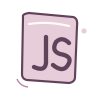
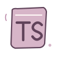

  

  ¡Hola! Desarrollo aplicaciones web, APIs y servicios backend. 

## Tecnologías

### Backend

  
  
  
  
  
  
  

### Frontend

  
  
  
  
  
  

### Bases de datos

  
  
  
  

### Herramientas e infraestructura

  
  
  
  
  
  
  

## Contacto

[GitHub](https://github.com/JhonatanCisne) · [LinkedIn](https://www.linkedin.com/in/cinerosjorgejhonataneduardo) · [Correo](mailto:jhonatanjorge151@gmail.com)
