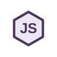
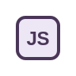
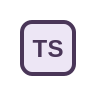

  
  

Desarrollo aplicaciones web, APIs y servicios backend. Me interesa crear soluciones funcionales y bien estructuradas.

## Tecnologías

### Backend

<table>
  <tr>
    <td align="center" width="126" valign="middle"> <strong>Java</strong></td>
    <td align="center" width="126" valign="middle"> <strong>Spring Boot</strong></td>
    <td align="center" width="126" valign="middle"> <strong>Spring Security</strong></td>
    <td align="center" width="126" valign="middle"> <strong>Python</strong></td>
  </tr>
  <tr>
    <td align="center" width="126" valign="middle"> <strong>FastAPI</strong></td>
    <td align="center" width="126" valign="middle"> <strong>Node.js</strong></td>
    <td align="center" width="126" valign="middle"> <strong>NestJS</strong></td>
  </tr>
</table>

### Frontend

<table>
  <tr>
    <td align="center" width="126" valign="middle"> <strong>JavaScript</strong></td>
    <td align="center" width="126" valign="middle"> <strong>TypeScript</strong></td>
    <td align="center" width="126" valign="middle"> <strong>React</strong></td>
    <td align="center" width="126" valign="middle"> <strong>HTML5</strong></td>
  </tr>
  <tr>
    <td align="center" width="126" valign="middle"> <strong>CSS3</strong></td>
    <td align="center" width="126" valign="middle"> <strong>Flutter</strong></td>
  </tr>
</table>

### Bases de datos

<table>
  <tr>
    <td align="center" width="126" valign="middle"> <strong>PostgreSQL</strong></td>
    <td align="center" width="126" valign="middle"> <strong>MySQL</strong></td>
    <td align="center" width="126" valign="middle"> <strong>MongoDB</strong></td>
    <td align="center" width="126" valign="middle"> <strong>Redis</strong></td>
  </tr>
</table>

### Herramientas e infraestructura

<table>
  <tr>
    <td align="center" width="126" valign="middle"> <strong>Docker</strong></td>
    <td align="center" width="126" valign="middle"> <strong>Git</strong></td>
    <td align="center" width="126" valign="middle"> <strong>GitHub</strong></td>
    <td align="center" width="126" valign="middle"> <strong>Linux</strong></td>
  </tr>
  <tr>
    <td align="center" width="126" valign="middle"> <strong>Nginx</strong></td>
    <td align="center" width="126" valign="middle"> <strong>Postman</strong></td>
    <td align="center" width="126" valign="middle"> <strong>Coolify</strong></td>
  </tr>
</table>

## Actividad en GitHub

  
  
  
  

## Contacto

[GitHub](https://github.com/JhonatanCisne) · [LinkedIn](https://www.linkedin.com/in/cinerosjorgejhonataneduardo) · [Correo](mailto:jhonatanjorge151@gmail.com)
